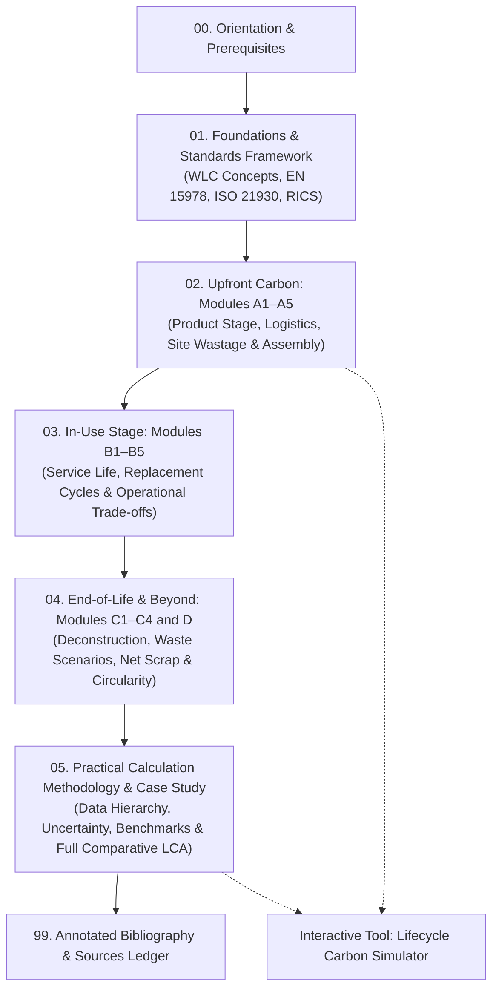

# Lifecycle Stages in the Construction Industry and Embodied Carbon Calculation

Welcome to this comprehensive mini-textbook on Whole Life Carbon (WLC) and embodied carbon calculation in the built environment. This course teaches how building life cycle stages—from raw material extraction through construction, operation, maintenance, demolition, and reuse—are formally categorized and mathematically linked to carbon accounting under international standards.

---

## Course Navigation and Lesson Path

### Table of Contents

1. [Lesson 01: Foundations of Whole Life Carbon and the Standards Framework](01-foundations-and-frameworks.md)
   * The climate imperative: operational decarbonization vs. the upfront carbon surge.
   * Definitions: Embodied Carbon, Operational Carbon, Upfront Carbon, and Whole Life Carbon.
   * The international standards hierarchy: BS EN 15978:2011, BS EN 15804:2012+A2:2019, ISO 21930:2017, and the RICS Whole Life Carbon Assessment Professional Standard (2nd edition, 2023).
   * Functional units, normalization metrics ($\text{kgCO}_2\text{e}/\text{m}^2 \text{ GIA}$), and system boundaries.

2. [Lesson 02: Upfront Carbon — The Product and Construction Stages (Modules A1–A5)](02-upfront-carbon-a1-a5.md)
   * Module A1–A3 (Product Stage): Cradle-to-gate extraction, processing, and manufacturing; reading Environmental Product Declarations (EPDs).
   * Module A4 (Transport to Site): Modal logistics, capacity factors, empty return trips, and vehicle emission factors.
   * Module A5 (Construction Installation): On-site plant diesel, electricity, temporary works, and material wastage equations.
   * Analytical formulation and worked derivation for a reinforced concrete structural bay.

3. [Lesson 03: The In-Use Stage (Modules B1–B5) and Operational Interplay](03-use-stage-b1-b5.md)
   * Embodied in-use mechanisms: B1 (use/in-situ carbonation), B2 (maintenance), B3 (repair), B4 (replacement), B5 (refurbishment).
   * Service life planning: Reference Service Life (RSL), Estimated Service Life (ESL), and Reference Study Period (RSP).
   * The mathematical replacement step function and carbon profile across a 60-year building lifecycle.
   * The "embodied carbon payback" trap: trading higher upfront embodied carbon for operational energy savings (B6).

4. [Lesson 04: End-of-Life (Modules C1–C4), Circularity, and Beyond the Lifecycle (Module D)](04-end-of-life-and-module-d.md)
   * Deconstruction and demolition (C1), transport to waste processing (C2), waste processing (C3), and final disposal (C4).
   * Module D: Benefits and loads beyond the system boundary; the net scrap accounting formula and the avoided burdens principle.
   * Biogenic carbon dynamics: $-1/+1$ static accounting versus dynamic radiative forcing.
   * Design for Deconstruction (DfD) and material circularity credits without double counting.

5. [Lesson 05: Practical Calculation Methodology, Benchmarking, and Case Study](05-calculation-methodology-and-case-study.md)
   * The five-tier carbon data hierarchy: from manufacturer-specific Type III EPDs to generic life cycle inventories (ICE Database v3.0).
   * Managing uncertainty ($\pm 15\% - 30\%$) and temporal grid decarbonization factors.
   * Target setting and rating systems: LETI 2030 Climate Emergency targets, RIBA 2030 Climate Challenge, and RICS benchmarks.
   * Comprehensive capstone case study: Comparative whole-life embodied carbon assessment of an office structure (Baseline Concrete vs. Low-Carbon Hybrid Mass Timber).

6. [Interactive Simulation: Whole Life Embodied Carbon Simulator](assets/interactive/embodied-carbon-calculator.html)
   * Self-contained browser tool to model building dimensions, structural frames, transport distances, wastage rates, replacement lifespans, and end-of-life recycling rates.

7. [Annotated Bibliography](99-bibliography.md)
   * Full citations and evidence assessments for all referenced standards, guidance documents, and peer-reviewed studies.

---

## Prerequisites and Target Audience

* **Audience:** Structural engineers, civil engineers, architects, cost consultants, quantity surveyors, and sustainability analysts who need a rigorous, mathematically consistent understanding of carbon accounting in construction.
* **Prerequisites:**
  * Basic familiarity with construction drawings, Bill of Quantities (BoQ), and building elements (substructure, superstructure, envelope, MEP).
  * Fundamental algebra and units conversion (mass, volume, density, distance).
  * Basic understanding of greenhouse gas emissions expressed in carbon dioxide equivalent ($\text{CO}_2\text{e}$).

---

## Estimated Study Effort

* Total estimated study time: **5 to 8 hours**.
* Module breakdown:
  * Lesson 01: 60 minutes
  * Lesson 02: 90 minutes
  * Lesson 03: 75 minutes
  * Lesson 04: 75 minutes
  * Lesson 05 & Case Study: 90 minutes
  * Interactive lab exercises & validation: 45 minutes

---

## Research Coverage and Limitations

This course synthesizes international standards and peer-reviewed research up to October 2026:
* **Normative Standards:** BS EN 15978:2011 [S01], BS EN 15804:2012+A2:2019 [S02], and ISO 21930:2017 [S03] define the modular framework.
* **Professional Guidance:** The Royal Institution of Chartered Surveyors (RICS) 2nd Edition *Whole Life Carbon Assessment for the Built Environment* (effective July 2024) [S04] and the Institution of Structural Engineers (IStructE) guide *How to calculate embodied carbon* [S05] provide the numerical rules, transport defaults, and wastage benchmarks.
* **Empirical Research:** Meta-analyses by Röck et al. (2020) [S08], Pomponi & Moncaster (2016) [S09], and De Wolf et al. (2017) [S10] supply empirical data on stage contributions and industry methodological variances.
* **Limitations:** Specific background Life Cycle Inventory (LCI) databases (such as ecoinvent or GaBi) require commercial software licenses; data factors presented herein reference open datasets (ICE Database v3.0 [S07]) and published third-party EPDs. Carbon grid intensity and future recycling technologies are subject to long-term macro-economic and policy uncertainties.
