# Lesson 01: Foundations of Whole Life Carbon and the Standards Framework

## Learning objectives

By the end of this lesson, you will be able to:
* Differentiate between **operational carbon**, **embodied carbon**, **upfront carbon**, and **whole life carbon** with precise boundary definitions.
* Map physical construction activities to the modular stages defined by **BS EN 15978:2011**, **ISO 21930:2017**, and the **RICS Whole Life Carbon Assessment Standard (2nd edition, 2023)** (Modules A0 through D).
* Explain why embodied carbon accounts for an increasing percentage (up to 50–90%) of lifetime emissions in high-efficiency buildings.
* Select and formulate standard functional units and normalization metrics ($\text{kgCO}_2\text{e}/\text{m}^2 \text{ GIA}$) across a defined **Reference Study Period (RSP)**.
* Distinguish between cradle-to-gate, cradle-to-practical-completion, cradle-to-grave, and cradle-to-cradle accounting boundaries.

---

## Key concepts

### 1. The Carbon Imperative: Operational vs. Embodied Carbon

Historically, building sustainability focused almost exclusively on **operational carbon**—the greenhouse gas (GHG) emissions arising from operational energy use (heating, cooling, ventilation, lighting, and power) and water consumption during the building's occupation [S08]. As building energy codes have tightened and electricity grids decarbonize via renewable generation, operational emissions per square meter have plummeted.

However, the materials required to construct buildings—principally concrete, steel, masonry, glass, aluminum, and insulation—carry substantial GHG emissions from resource extraction, chemical processing, high-temperature manufacturing, and global transport [S07]. These emissions are termed **embodied carbon**.

```
Whole Life Carbon (WLC) = Embodied Carbon (A1–A5, B1–B5, C1–C4) + Operational Carbon (B6, B7)
```

In conventional inefficient buildings evaluated over a 60-year lifespan, operational carbon historically accounted for 70% to 80% of total lifetime emissions, with embodied carbon representing only 20% to 30% [S08]. In contemporary high-efficiency buildings (such as Passive House or Net Zero Operational Carbon assets), this ratio reverses: embodied carbon typically accounts for 45% to over 70% of lifetime emissions [S08], and on Day 1 of building completion, **upfront embodied carbon accounts for 100% of emissions released to date**.

Because upfront carbon emissions occur immediately during the construction phase (Modules A1–A5), they consume our rapidly diminishing global carbon budget decades before future operational savings can materialize [S06, S08]. This phenomenon is known as the **time value of carbon**.

---

### 2. The Modular Life Cycle Framework (EN 15978 & ISO 21930)

To avoid ambiguity, omissions, or double counting, international standards establish a strictly modular life cycle structure [S01, S03]. The global baseline is set by **BS EN 15978:2011** and reinforced by **ISO 21930:2017** and the **RICS Whole Life Carbon Assessment Professional Standard (2nd edition, 2023)** [S04].

The lifecycle is partitioned into five distinct stages:

| Stage | Module | Designator | Description & Core Activities |
| :--- | :--- | :--- | :--- |
| **Pre-Construction** | A0 | Strategic Assessment | Early site surveys, briefing, concept design, client decisions (introduced in RICS 2nd ed.) [S04] |
| **Product Stage** | A1 | Raw material extraction | Quarrying aggregates, mining iron ore, felling timber, petroleum extraction |
| | A2 | Transport to manufacturer | Freight from extraction points to processing mills and manufacturing plants |
| | A3 | Manufacturing | Clinker burning (calcination), steel smelting, brick firing, assembly |
| **Construction Stage** | A4 | Transport to construction site | Road, rail, sea, or air freight from factory gate to the construction site |
| | A5 | Installation & on-site works | Site energy (diesel cranes, site cabins), material wastage, packaging disposal |
| **Use Stage** | B1 | In-situ use / weathering | Direct GHG release or uptake (e.g., concrete carbonation, refrigerant leakage) |
| | B2 | Maintenance | Routine cleaning and minor component upkeep over building life |
| | B3 | Repair | Corrective actions restoring damaged elements to working order |
| | B4 | Replacement | Full replacement of short-lived components (MEP, roof membranes, carpets, glazing) |
| | B5 | Refurbishment | Major structural or spatial alterations, tenant fit-out cycles |
| | B6 | Operational energy | Regulated energy (HVAC, lighting) and unregulated plug loads [S01] |
| | B7 | Operational water | Potable water supply, treatment, and wastewater disposal [S01] |
| **End of Life** | C1 | Deconstruction & demolition | Mechanical demolition, craneage, sorting on site |
| | C2 | Transport of discarded items | Freight from site to waste processing facilities or landfill |
| | C3 | Waste processing | Crushing concrete into aggregate, shredding timber, sorting scrap metal |
| | C4 | Disposal | Final deposit in landfill or incineration without energy recovery |
| **Beyond Boundary** | **Module D** | Reuse, recovery & recycling | Net benefits and loads of exported energy, recycled scrap steel, and reused components [S01, S02] |

> [!IMPORTANT]
> **Reporting Rule for Module D:** Under both EN 15978 [S01] and EN 15804+A2 [S02], **Module D must always be reported separately and never added or subtracted from the total of Modules A1–C4**. This prevents the appearance of a false "negative" carbon footprint while transparently showing circular economy benefits.

---

### 3. System Boundaries in Whole Life Carbon

Depending on the scope of the study, practitioners define the **system boundary** along standardized milestones:

1. **Cradle-to-Gate (Modules A1–A3):** Evaluates products up to the manufacturing factory gate. This is the standard boundary for product Environmental Product Declarations (EPDs) [S02, S07].
2. **Cradle-to-Practical Completion / Upfront Carbon (Modules A1–A5):** All emissions released up to the physical handover of the building to the client [S04, S06].
3. **Cradle-to-Grave (Modules A1–C4):** The complete life cycle of the building from initial raw material extraction to final demolition and disposal [S01, S04].
4. **Cradle-to-Cradle (Modules A1–C4 plus Module D):** Incorporates the circular economic potential beyond the building’s lifecycle into the secondary materials market [S01, S04].

---

### 4. Functional Units and Normalization

To compare different building designs, structural options, or whole assets objectively, carbon calculations must be normalized against a standardized **functional unit** [S01, S04]:

$$\text{Carbon Intensity} = \frac{\text{Total Carbon Emissions } (\text{kgCO}_2\text{e})}{\text{Functional Area } (\text{m}^2) \times \text{Reference Study Period } (\text{years})}$$

* **Functional Area:** In the UK and internationally under RICS, the primary area denominator is **Gross Internal Area (GIA)** in square meters ($\text{m}^2$), defined as the total enclosed area within the external building envelope [S04]. Other frameworks (such as French RE2020 or German BNB) use usable floor area ($\text{SDP}$ or $\text{NGF}$), making international comparisons sensitive to area definitions [S10].
* **Reference Study Period (RSP):** The standard assessment horizon. For commercial, institutional, and residential buildings, standard practice sets $\text{RSP} = 60\text{ years}$ [S04]. For temporary structures, $\text{RSP}$ may be 5 to 15 years; for infrastructure (bridges, tunnels), $\text{RSP}$ is typically 100 to 120 years.

---

## Worked example

### Problem Statement

An engineering team is conducting an initial whole life carbon screening for a 6-story commercial office building in London with a Gross Internal Area ($\text{GIA}$) of $8{,}000\text{ m}^2$ and an intended Reference Study Period ($\text{RSP}$) of $60\text{ years}$.

The initial carbon screening estimates the following absolute GHG emissions across its lifecycle modules:
* Product Stage ($A1–A3$): $2{,}400{,}000\text{ kgCO}_2\text{e}$
* Construction Stage Logistics & Site ($A4–A5$): $480{,}000\text{ kgCO}_2\text{e}$
* In-Use Maintenance, Repair & Replacement ($B1–B5$): $1{,}200{,}000\text{ kgCO}_2\text{e}$
* Operational Energy & Water ($B6–B7$): $2{,}880{,}000\text{ kgCO}_2\text{e}$ (assuming UK grid decarbonization trajectory)
* End of Life Demolition & Disposal ($C1–C4$): $240{,}000\text{ kgCO}_2\text{e}$
* Circular Economy Recovery Potential ($\text{Module D}$): $-640{,}000\text{ kgCO}_2\text{e}$

**Calculate:**
1. Upfront Embodied Carbon intensity per square meter ($\text{kgCO}_2\text{e}/\text{m}^2 \text{ GIA}$).
2. Total Embodied Carbon intensity ($A1–A5, B1–B5, C1–C4$) per square meter.
3. Whole Life Carbon ($\text{WLC}$) intensity ($A1–C4$) per square meter.
4. The percentage contribution of upfront carbon to the total cradle-to-grave WLC.
5. Correctly state the reporting of Module D.

---

### Step-by-Step Solution

#### 1. Upfront Embodied Carbon (A1–A5)

$$\text{Upfront Carbon} = (A1–A3) + (A4–A5) = 2{,}400{,}000 + 480{,}000 = 2{,}880{,}000\text{ kgCO}_2\text{e}$$

Normalize by the functional area ($\text{GIA} = 8{,}000\text{ m}^2$):

$$\text{Upfront Carbon Intensity} = \frac{2{,}880{,}000\text{ kgCO}_2\text{e}}{8{,}000\text{ m}^2} = 360\text{ kgCO}_2\text{e}/\text{m}^2 \text{ GIA}$$

#### 2. Total Embodied Carbon (A1–C4 excluding B6–B7)

$$\text{Total Embodied Carbon} = (A1–A5) + (B1–B5) + (C1–C4)$$
$$\text{Total Embodied Carbon} = 2{,}880{,}000 + 1{,}200{,}000 + 240{,}000 = 4{,}320{,}000\text{ kgCO}_2\text{e}$$

Normalize by GIA:

$$\text{Embodied Carbon Intensity} = \frac{4{,}320{,}000\text{ kgCO}_2\text{e}}{8{,}000\text{ m}^2} = 540\text{ kgCO}_2\text{e}/\text{m}^2 \text{ GIA}$$

#### 3. Whole Life Carbon (WLC: A1–C4)

$$\text{WLC} = \text{Total Embodied Carbon} + \text{Operational Carbon } (B6–B7)$$
$$\text{WLC} = 4{,}320{,}000 + 2{,}880{,}000 = 7{,}200{,}000\text{ kgCO}_2\text{e} = 7{,}200\text{ tCO}_2\text{e}$$

Normalize by GIA:

$$\text{WLC Intensity} = \frac{7{,}200{,}000\text{ kgCO}_2\text{e}}{8{,}000\text{ m}^2} = 900\text{ kgCO}_2\text{e}/\text{m}^2 \text{ GIA}$$

#### 4. Upfront Carbon Share of Lifetime WLC

$$\text{Upfront Share} = \frac{\text{Upfront Carbon }(A1–A5)}{\text{Total WLC }(A1–C4)} = \frac{2{,}880{,}000}{7{,}200{,}000} \times 100\% = 40.0\%$$

Notice that upfront carbon alone represents $40\%$ of all greenhouse gases the building will ever be responsible for over 60 years, all released before occupation! Furthermore, total embodied carbon ($A1–A5 + B1–B5 + C1–C4$) represents:

$$\text{Total Embodied Share} = \frac{4{,}320{,}000}{7{,}200{,}000} \times 100\% = 60.0\%$$

This illustrates the findings of Röck et al. (2020) [S08]: in modern energy-efficient designs, embodied carbon dominates over operational carbon.

#### 5. Reporting Module D

Module D is reported strictly as supplementary information:

$$\text{Module D Intensity} = \frac{-640{,}000\text{ kgCO}_2\text{e}}{8{,}000\text{ m}^2} = -80\text{ kgCO}_2\text{e}/\text{m}^2 \text{ GIA}$$

In the compliance dashboard, the result is reported as:
* **Whole Life Carbon (Modules A1–C4):** $900\text{ kgCO}_2\text{e}/\text{m}^2 \text{ GIA}$ ($7{,}200\text{ tCO}_2\text{e}$)
* **Circularity Benefits Beyond System Boundary (Module D):** $-80\text{ kgCO}_2\text{e}/\text{m}^2 \text{ GIA}$ ($-640\text{ tCO}_2\text{e}$)
* The reported total is **not** $900 - 80 = 820\text{ kgCO}_2\text{e}/\text{m}^2$.

---

## Visual explanation

The diagram below outlines the modular stages defined by EN 15978 [S01] and ISO 21930 [S03], highlighting the system boundaries and the strict separation of Module D.

```mermaid
flowchart LR
    subgraph CradleToGate["Cradle-to-Gate (EPD Boundary)"]
        A1["A1: Raw Material Supply"] --> A2["A2: Transport to Mill"]
        A2 --> A3["A3: Manufacturing"]
    end

    subgraph Upfront["Upfront Carbon Boundary (A1–A5)"]
        CradleToGate --> A4["A4: Transport to Site"]
        A4 --> A5["A5: Site Installation & Waste"]
    end

    subgraph InUse["Use Stage (B1–B7)"]
        Upfront --> B1["B1: In-Situ Use"]
        B1 --> B2["B2: Maintenance"]
        B2 --> B3["B3: Repair"]
        B3 --> B4["B4: Replacement"]
        B4 --> B5["B5: Refurbishment"]
        B5 --> B6["B6: Operational Energy"]
        B6 --> B7["B7: Operational Water"]
    end

    subgraph EndOfLife["End-of-Life Stage (C1–C4)"]
        InUse --> C1["C1: Demolition"]
        C1 --> C2["C2: Transport Waste"]
        C2 --> C3["C3: Waste Processing"]
        C3 --> C4["C4: Final Disposal"]
    end

    subgraph Beyond["Beyond System Boundary"]
        EndOfLife -. "Recycled Scrap & Reused Elements" .-> D["Module D: Benefits & Loads Beyond Boundary"]
    end

    classDef stageA fill:#dbeafe,stroke:#1d4ed8,stroke-width:2px;
    classDef stageB fill:#fef3c7,stroke:#d97706,stroke-width:2px;
    classDef stageC fill:#fee2e2,stroke:#dc2626,stroke-width:2px;
    classDef stageD fill:#dcfce7,stroke:#16a34a,stroke-width:2px,stroke-dasharray: 5 5;

    class A1,A2,A3,A4,A5 stageA;
    class B1,B2,B3,B4,B5,B6,B7 stageB;
    class C1,C2,C3,C4 stageC;
    class D stageD;
```



### Reading the Diagram

1. **Modules A1–A3** represent the industrial supply chain. Product manufacturers declare this cradle-to-gate boundary in Type III Environmental Product Declarations (EPDs).
2. **Modules A4–A5** add transport logistics to the project site, construction plant machinery, and on-site material waste disposal, forming the **Upfront Carbon** boundary.
3. **Modules B1–B5** capture the ongoing embodied turnover of building components (maintenance, repairs, replacements, and major tenant fit-outs) alongside continuous operational energy (B6) and water (B7).
4. **Modules C1–C4** close the building's physical existence through demolition, sorting, and disposal.
5. **Module D** is drawn with a dashed boundary: it captures the net environmental benefits (avoided virgin extraction) that materials leaving the building confer upon future secondary product systems.

---

## Practice

### Exercise 1: Boundary Identification

A project team is conducting an embodied carbon assessment for an educational facility. For each of the following activities, assign the correct EN 15978 / RICS module code (e.g., A1, A4, B4, C3, Module D):
1. Electricity consumed by a tower crane during column erection.
2. Replacing all carpet tiles after 12 years of wear.
3. Diesel burned by heavy goods vehicles (HGVs) hauling structural timber 250 km to site.
4. Crushing demolished foundation concrete on-site to be used as road sub-base in a neighboring future development.
5. Carbon dioxide released during limestone calcination in a cement kiln.

### Exercise 2: Functional Unit Calculation

A residential apartment tower has a Gross Internal Area ($\text{GIA}$) of $12{,}500\text{ m}^2$. The carbon inventory indicates:
* Product stage ($A1–A3$): $4{,}375{,}000\text{ kgCO}_2\text{e}$
* Transport to site ($A4$): $250{,}000\text{ kgCO}_2\text{e}$
* Site installation & waste ($A5$): $375{,}000\text{ kgCO}_2\text{e}$
* Component replacements over 60-year RSP ($B4$): $1{,}500{,}000\text{ kgCO}_2\text{e}$
* Demolition and end-of-life ($C1–C4$): $312{,}500\text{ kgCO}_2\text{e}$

Compute:
1. The Upfront Carbon intensity ($\text{kgCO}_2\text{e}/\text{m}^2 \text{ GIA}$).
2. The Cradle-to-Grave Embodied Carbon intensity ($\text{kgCO}_2\text{e}/\text{m}^2 \text{ GIA}$).
3. If an industry design benchmark requires Upfront Carbon to be below $400\text{ kgCO}_2\text{e}/\text{m}^2 \text{ GIA}$, does this project comply?

---

### Answers and hints

#### Exercise 1 Answers
1. **Module A5** (Installation and site activities).
2. **Module B4** (Replacement of components within the use stage).
3. **Module A4** (Transport of products to the construction site).
4. **Module C3** (Waste processing for recycling) for the crushing process; the avoided burden of virgin aggregate in the new road is credited to **Module D**.
5. **Module A3** (Manufacturing process emissions in the product stage).

#### Exercise 2 Answers
1. Upfront carbon ($A1–A5$):
   $$\text{Total } A1–A5 = 4{,}375{,}000 + 250{,}000 + 375{,}000 = 5{,}000{,}000\text{ kgCO}_2\text{e}$$
   $$\text{Upfront Intensity} = \frac{5{,}000{,}000\text{ kgCO}_2\text{e}}{12{,}500\text{ m}^2} = 400.0\text{ kgCO}_2\text{e}/\text{m}^2 \text{ GIA}$$
2. Cradle-to-grave embodied carbon ($A1–C4$):
   $$\text{Total Embodied} = 5{,}000{,}000 + 1{,}500{,}000 + 312{,}500 = 6{,}812{,}500\text{ kgCO}_2\text{e}$$
   $$\text{Embodied Intensity} = \frac{6{,}812{,}500\text{ kgCO}_2\text{e}}{12{,}500\text{ m}^2} = 545.0\text{ kgCO}_2\text{e}/\text{m}^2 \text{ GIA}$$
3. Benchmark compliance:
   The project equals $400\text{ kgCO}_2\text{e}/\text{m}^2$. To meet a strict requirement of $<400\text{ kgCO}_2\text{e}/\text{m}^2$, the team must achieve modest reductions (e.g., optimizing cement blends in A1–A3 or reducing site wastage in A5).

---

## Next steps

Now that you understand the overarching modular framework and the definition of Whole Life Carbon, proceed to [Lesson 02: Upfront Carbon — The Product and Construction Stages (Modules A1–A5)](02-upfront-carbon-a1-a5.md). In Lesson 02, we examine how to read Environmental Product Declarations (EPDs), calculate freight ton-kilometers for Module A4, and model on-site material wastage mathematics in Module A5.

You can also explore these initial stage splits interactively in the [Whole Life Embodied Carbon Simulator](assets/interactive/embodied-carbon-calculator.html).

---

## References

- [S01] British Standards Institution / CEN. (2011). *BS EN 15978:2011: Sustainability of construction works — Assessment of environmental performance of buildings — Calculation method*. BSI Standards Limited. URL: https://knowledge.bsigroup.com/products/sustainability-of-construction-works-assessment-of-environmental-performance-of-buildings-calculation-method
- [S02] British Standards Institution / CEN. (2019). *BS EN 15804:2012+A2:2019: Sustainability of construction works — Environmental product declarations — Core rules for the product category of construction products*. BSI Standards Limited. URL: https://standards.iteh.ai/catalog/standards/cen/5e3df5f5-ef85-48b9-823a-fcf7e19ec355/en-15804-2012-a2-2019
- [S03] International Organization for Standardization. (2017). *ISO 21930:2017: Sustainability in buildings and civil engineering works — Core rules for environmental product declarations of construction products and services*. ISO. URL: https://www.iso.org/standard/62545.html
- [S04] Royal Institution of Chartered Surveyors. (2023). *Whole life carbon assessment for the built environment* (2nd ed.). RICS Professional Standard. URL: https://www.rics.org/profession-standards/rics-standards-and-guidance/sector-standards/building-surveying-standards/whole-life-carbon-assessment
- [S06] London Energy Transformation Initiative (LETI). (2020). *LETI Embodied Carbon Primer: Supplementary guidance to the Climate Emergency Design Guide*. LETI. URL: https://www.leti.uk/ecp
- [S07] Jones, C., & Hammond, G. (2019). *Inventory of Carbon and Energy (ICE) Version 3.0*. Circular Ecology / University of Bath. URL: https://circularecology.com/embodied-carbon-footprint-database.html
- [S08] Röck, M., Saade, M. R. M., Balouktsi, M., Rasmussen, F. N., Birgisdottir, H., Frischknecht, R., Habert, G., Lützkendorf, T., & Passer, A. (2020). *Embodied GHG emissions of buildings – The hidden challenge for effective climate change mitigation*. *Applied Energy*, 258, 114107. DOI: 10.1016/j.apenergy.2019.114107
- [S10] De Wolf, C., Pomponi, F., & Moncaster, A. (2017). *Measuring embodied carbon dioxide equivalent of buildings: A review and critique of current industry practice*. *Energy and Buildings*, 140, 68–80. DOI: 10.1016/j.enbuild.2017.01.075
