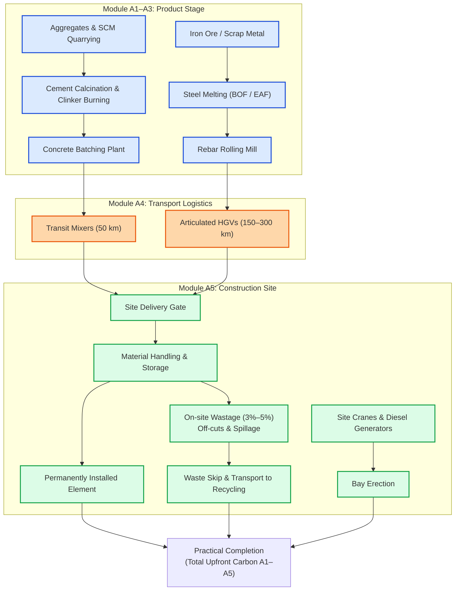

# Lesson 02: Upfront Carbon — The Product and Construction Stages (Modules A1–A5)

## Learning objectives

By the end of this lesson, you will be able to:
* Formulate and compute the mathematical equations governing **Upfront Embodied Carbon** (Modules A1–A5) per BS EN 15978 and RICS standards.
* Interpret Type III **Environmental Product Declarations (EPDs)** conforming to BS EN 15804+A2:2019, specifically distinguishing between $\text{GWP-fossil}$ and $\text{GWP-biogenic}$.
* Calculate freight emissions in **Module A4** using mass-distance logistics modeling, payload capacities, and transport mode emission factors.
* Model the compounding effect of **site material wastage rates** in **Module A5** on raw material extraction (A1–A3) and transport (A4).
* Quantify on-site installation energy, site accommodation emissions, and construction waste disposal.

---

## Key concepts

### 1. The Composition of Upfront Carbon

**Upfront Carbon** encompasses all greenhouse gas emissions released from the initial extraction of raw earth materials up to the practical completion of the building asset [S04, S06]. It comprises two primary life cycle stages:

1. **The Product Stage (Modules A1–A3):** Cradle-to-factory-gate production of building components.
2. **The Construction Process Stage (Modules A4–A5):** Transportation to the jobsite and physical assembly on-site.

Upfront carbon is mathematically formulated as:

$$\text{EC}_{\text{upfront}} = \text{EC}_{A1-A3} + \text{EC}_{A4} + \text{EC}_{A5}$$

---

### 2. Module A1–A3: Product Stage and EPD Mechanics

The product stage captures the industrial processing chain [S01, S02]:
* **A1 (Raw Material Supply):** Extraction of ores, quarrying limestone and aggregates, forestry, and fossil feedstocks.
* **A2 (Transport to Manufacturer):** Freight transporting extracted raw ingredients to smelting mills, cement kilns, or fabrication plants.
* **A3 (Manufacturing):** High-temperature processing, chemical synthesis, machining, and final component fabrication.

#### Primary Material Emission Mechanisms
* **Cement & Concrete:** In ordinary Portland cement (CEM I), approximately 60% of emissions stem from chemical **calcination** ($\text{CaCO}_3 \rightarrow \text{CaO} + \text{CO}_2$) occurring at $1450^\circ\text{C}$, with the remaining 40% from fossil fuel combustion to fire the kiln [S05, S07]. Replacing CEM I with Supplementary Cementitious Materials (SCMs) such as Ground Granulated Blast-furnace Slag (GGBS) or Pulverized Fuel Ash (PFA) dramatically reduces A1–A3 emissions.
* **Structural Steel:** Primary steelmaking via the Blast Furnace-Basic Oxygen Furnace (BF-BOF) route typically yields $2.0 \text{ to } 2.5\text{ kgCO}_2\text{e}/\text{kg}$ of steel [S07]. Secondary steelmaking via the Electric Arc Furnace (EAF) route utilizing 90%+ scrap metal yields $0.4 \text{ to } 0.8\text{ kgCO}_2\text{e}/\text{kg}$ [S05, S07].
* **Timber:** Trees sequester atmospheric carbon dioxide via photosynthesis ($6\text{CO}_2 + 6\text{H}_2\text{O} \rightarrow \text{C}_6\text{H}_{12}\text{O}_6 + 6\text{O}_2$). Under EN 15804+A2 [S02], this biogenic carbon storage is reported as a negative emission ($-1$) in Module A1–A3, but must be paired with fossil emissions from harvesting, drying kilns, resin production, and fabrication.

#### Reading Modern EPDs (BS EN 15804+A2:2019)
Under the A2 amendment of EN 15804 [S02], EPDs no longer provide a single Global Warming Potential ($\text{GWP}$) number. They mandate four distinct sub-indicators:
* $\text{GWP-fossil}$: GHG emissions from fossil fuels and industrial calcination.
* $\text{GWP-biogenic}$: Carbon removals into biomass (negative) and physical releases (positive).
* $\text{GWP-luluc}$: Emissions from land use and land use change.
* $\text{GWP-total}$: The arithmetic sum of fossil, biogenic, and luluc impacts.

> [!CAUTION]
> **Biogenic Carbon Masking:** When assessing building frames, never use $\text{GWP-total}$ of timber to claim that a building has "zero upfront carbon" if the wood will release that stored carbon at end of life. The RICS Whole Life Carbon Standard [S04] and IStructE [S05] mandate that **fossil emissions and biogenic carbon storage must be reported transparently and tracked through end-of-life modules C3/C4**.

---

### 3. Module A4: Transport to Construction Site

Module A4 covers freight from the manufacturer's gate to the construction site [S01, S04]. Transportation carbon depends on three variables:
1. The **mass** of material transported ($M_i$ in tonnes).
2. The **one-way distance** travelled ($d_i$ in kilometers).
3. The **mode-specific emission factor** ($\text{EF}_{\text{trans}, m}$ in $\text{kgCO}_2\text{e}/(\text{t}\cdot\text{km})$), accounting for vehicle capacity utilization and empty return trips.

$$\text{EC}_{A4} = \sum_i M_i \times d_i \times \text{EF}_{\text{trans}, m}$$

#### Standard Default Transport Scenarios (RICS 2023 & IStructE 2022)
When supplier-specific factory locations are unknown during early design stages, the RICS standard [S04] and IStructE guidance [S05] provide empirical default scenarios:

| Material Origin | Default Mode | One-Way Distance ($d$) | Emission Factor ($\text{EF}_{\text{trans}}$) [S04, S05] |
| :--- | :--- | :--- | :--- |
| **Locally sourced (Ready-mix concrete, aggregates)** | Rigid HGV (>17t) | 50 km | $0.134\text{ kgCO}_2\text{e}/(\text{t}\cdot\text{km})$ |
| **Nationally sourced (Precast concrete, bricks, rebar)** | Articulated HGV (>33t) | 300 km | $0.088\text{ kgCO}_2\text{e}/(\text{t}\cdot\text{km})$ |
| **European imports (Structural steel sections, CLT)** | Articulated HGV + Ferry | 1,500 km road + 200 km sea | Road: $0.088$; Sea: $0.016\text{ kgCO}_2\text{e}/(\text{t}\cdot\text{km})$ |
| **Global imports (Stone cladding, specialized glass)** | Container Ship | 10,000 km sea | $0.012\text{ kgCO}_2\text{e}/(\text{t}\cdot\text{km})$ |

---

### 4. Module A5: Construction Installation and Site Wastage

Module A5 accounts for all activities required to install components on site [S01, S04]. It is divided into two distinct sub-components:
* **Module A5.site (Site activities):** Direct fuel burned by site plant (excavators, mobile piling rigs, tower cranes, mobile elevating work platforms), electricity consumed by site cabins and tools, and temporary works (scaffolding, formwork timber).
* **Module A5.waste (Material wastage):** The embodied carbon of surplus materials ordered, delivered, and discarded due to cutting off-cuts, handling damage, and over-ordering.

#### The Compounding Mathematical Effect of Material Wastage
When a structural drawing calls for a net installed quantity of material $M_{\text{installed}}$, the contractor must purchase an inflated gross quantity $M_{\text{purchased}}$ to cover the site wastage rate $W_i$ (expressed as a decimal, e.g., $5\% = 0.05$) [S05]:

$$M_{\text{purchased}, i} = M_{\text{installed}, i} \times (1 + W_i)$$

Because that surplus material had to be manufactured ($A1–A3$) and delivered to site ($A4$), **site wastage increases the upstream A1–A4 footprint**:

$$\text{EC}_{A1-A3, \text{gross}} = \sum_i M_{\text{installed}, i} \times (1 + W_i) \times \text{EF}_{A1-A3, i}$$
$$\text{EC}_{A4, \text{gross}} = \sum_i M_{\text{installed}, i} \times (1 + W_i) \times d_i \times \text{EF}_{\text{trans}, i}$$

The disposal of that wasted material on-site is then booked directly into Module A5 [S04, S05]:

$$\text{EC}_{A5.\text{waste}} = \sum_i \left( M_{\text{installed}, i} \times W_i \right) \times \left( d_{\text{waste}} \times \text{EF}_{\text{trans}} + \text{EF}_{\text{waste-treatment}} \right)$$

#### Typical Benchmark Wastage Rates (IStructE 2022 & RICS 2023) [S04, S05]
* In-situ cast concrete: $3\% \text{ to } 5\%$
* Fabricated structural steel: $1\% \text{ to } 2\%$
* Reinforcing steel (rebar cut and bent on site): $5\% \text{ (or } 1\% \text{ if factory pre-cut)}$
* Facing brickwork / concrete blocks: $5\% \text{ to } 10\%$
* Plasterboard / internal linings: $10\% \text{ to } 15\%$

---

## Worked example

### Problem Statement

Calculate the total Upfront Embodied Carbon (Modules A1–A5) for the construction of a reinforced concrete structural bay in a commercial building.

The structural schedule specifies:
1. **Concrete:** $120\text{ m}^3$ of in-situ grade C30/37 concrete.
   * Density: $2{,}400\text{ kg}/\text{m}^3$.
   * A1–A3 Emission Factor: $0.115\text{ kgCO}_2\text{e}/\text{kg}$ (low-carbon concrete with 50% GGBS substitution) [S07].
   * Wastage rate ($W_{\text{conc}}$): $5\%$ ($0.05$).
   * Delivery: Local batching plant, $25\text{ km}$ via ready-mix transit mixer ($\text{EF}_{\text{trans}} = 0.160\text{ kgCO}_2\text{e}/(\text{t}\cdot\text{km})$) [S05].
2. **Reinforcing Steel (Rebar):** $14.4\text{ tonnes}$ ($14{,}400\text{ kg}$) of high-yield deformed steel rebar.
   * A1–A3 Emission Factor: $0.780\text{ kgCO}_2\text{e}/\text{kg}$ (EAF UK/EU recycled steel) [S05, S07].
   * Wastage rate ($W_{\text{rebar}}$): $3\%$ ($0.03$).
   * Delivery: National fabricator, $150\text{ km}$ via articulated HGV ($\text{EF}_{\text{trans}} = 0.088\text{ kgCO}_2\text{e}/(\text{t}\cdot\text{km})$) [S04].
3. **On-Site Installation (A5.site):**
   * Tower crane, vibrators, and site power allocate $1{,}250\text{ kgCO}_2\text{e}$ of fuel and grid electricity for this bay.
4. **Site Waste Processing (A5.waste):**
   * Disposal transport and recycling treatment for construction waste equals $18.5\text{ kgCO}_2\text{e}/\text{tonne}$ of wasted material [S04].

---

### Step-by-Step Solution

#### Step 1: Material Quantities and Masses

* **Concrete Mass:**
  $$M_{\text{installed, conc}} = 120\text{ m}^3 \times 2{,}400\text{ kg}/\text{m}^3 = 288{,}000\text{ kg} = 288.0\text{ tonnes}$$
  $$M_{\text{purchased, conc}} = 288.0\text{ t} \times (1 + 0.05) = 302.4\text{ tonnes} = 302{,}400\text{ kg}$$

* **Rebar Mass:**
  $$M_{\text{installed, rebar}} = 14.4\text{ tonnes} = 14{,}400\text{ kg}$$
  $$M_{\text{purchased, rebar}} = 14.4\text{ t} \times (1 + 0.03) = 14.832\text{ tonnes} = 14{,}832\text{ kg}$$

---

#### Step 2: Module A1–A3 (Product Stage with Wastage Allowance)

* **Concrete A1–A3:**
  $$\text{EC}_{A1-A3, \text{conc}} = 302{,}400\text{ kg} \times 0.115\text{ kgCO}_2\text{e}/\text{kg} = 34{,}776.0\text{ kgCO}_2\text{e}$$

* **Rebar A1–A3:**
  $$\text{EC}_{A1-A3, \text{rebar}} = 14{,}832\text{ kg} \times 0.780\text{ kgCO}_2\text{e}/\text{kg} = 11{,}568.96\text{ kgCO}_2\text{e}$$

* **Total Module A1–A3:**
  $$\text{EC}_{A1-A3} = 34{,}776.0 + 11{,}568.96 = 46{,}344.96\text{ kgCO}_2\text{e} \approx 46.34\text{ tCO}_2\text{e}$$

---

#### Step 3: Module A4 (Transport to Site)

* **Concrete Freight:**
  $$\text{EC}_{A4, \text{conc}} = 302.4\text{ tonnes} \times 25\text{ km} \times 0.160\text{ kgCO}_2\text{e}/(\text{t}\cdot\text{km}) = 1{,}209.6\text{ kgCO}_2\text{e}$$

* **Rebar Freight:**
  $$\text{EC}_{A4, \text{rebar}} = 14.832\text{ tonnes} \times 150\text{ km} \times 0.088\text{ kgCO}_2\text{e}/(\text{t}\cdot\text{km}) = 195.78\text{ kgCO}_2\text{e}$$

* **Total Module A4:**
  $$\text{EC}_{A4} = 1{,}209.6 + 195.78 = 1{,}405.38\text{ kgCO}_2\text{e} \approx 1.41\text{ tCO}_2\text{e}$$

---

#### Step 4: Module A5 (Site Installation & Site Waste Disposal)

* **Direct Site Installation Energy (A5.site):**
  $$\text{EC}_{A5.\text{site}} = 1{,}250.0\text{ kgCO}_2\text{e}$$

* **Site Waste Generated:**
  $$M_{\text{waste, conc}} = 302.4 - 288.0 = 14.4\text{ tonnes}$$
  $$M_{\text{waste, rebar}} = 14.832 - 14.4 = 0.432\text{ tonnes}$$
  $$\text{Total Wasted Material} = 14.4 + 0.432 = 14.832\text{ tonnes}$$

* **Waste Disposal & Processing Emissions (A5.waste):**
  $$\text{EC}_{A5.\text{waste}} = 14.832\text{ tonnes} \times 18.5\text{ kgCO}_2\text{e}/\text{tonne} = 274.39\text{ kgCO}_2\text{e}$$

* **Total Module A5:**
  $$\text{EC}_{A5} = 1{,}250.0 + 274.39 = 1{,}524.39\text{ kgCO}_2\text{e} \approx 1.52\text{ tCO}_2\text{e}$$

---

#### Step 5: Total Upfront Embodied Carbon (A1–A5)

$$\text{EC}_{\text{upfront}} = \text{EC}_{A1-A3} + \text{EC}_{A4} + \text{EC}_{A5}$$
$$\text{EC}_{\text{upfront}} = 46{,}344.96 + 1{,}405.38 + 1{,}524.39 = 49{,}274.73\text{ kgCO}_2\text{e} \approx 49.27\text{ tCO}_2\text{e}$$

#### Summary Breakdown:
* **Product Stage ($A1–A3$):** $46{,}345\text{ kgCO}_2\text{e}$ ($94.0\%$)
* **Transport ($A4$):** $1{,}405\text{ kgCO}_2\text{e}$ ($2.9\%$)
* **Site Works & Waste ($A5$):** $1{,}524\text{ kgCO}_2\text{e}$ ($3.1\%$)

Notice that **Product Stage (A1–A3)** dominates upfront carbon by over 90%, highlighting why low-carbon material specifications (e.g. SCM replacement in concrete, recycled steel) are the primary levers for upfront decarbonization [S05, S06].

---

## Visual explanation

The diagram below tracks how raw materials are extracted, transported, and compounded by on-site wastage during physical erection.

### Reading the Diagram

* Upstream extraction and manufacturing generate over 90% of the greenhouse gas burden before any truck leaves the depot.
* Materials flowing into Module A4 are not merely the net designed volume; they must include the additional volume destined to become scrap on site.
* On the jobsite (Module A5), materials split into permanently incorporated structural fabric versus wasted material routed to disposal skips.

---

## Practice

### Exercise 1: Compounding Effect of Wastage

A commercial building specifies $200\text{ tonnes}$ of structural steelwork.
* Steel A1–A3 emission factor: $1.80\text{ kgCO}_2\text{e}/\text{kg}$.
* Transport distance to site: $200\text{ km}$ at $0.088\text{ kgCO}_2\text{e}/(\text{t}\cdot\text{km})$.
* Case 1: Prefabricated modular frames with a factory-controlled wastage rate of $1\%$.
* Case 2: Site-cut beam sections with a wastage rate of $6\%$.

Calculate:
1. The gross mass of steel purchased for Case 1 and Case 2.
2. The combined A1–A4 carbon emissions for Case 1 and Case 2.
3. How many tonnes of $\text{CO}_2\text{e}$ are saved simply by shifting cutting and detailing off-site to reduce wastage from $6\%$ to $1\%$?

### Exercise 2: Evaluating Transport Penalties

An architect is comparing two cladding stone options:
* **Option A (Local Granite):** Transported $80\text{ km}$ by rigid HGV ($\text{EF} = 0.134\text{ kgCO}_2\text{e}/(\text{t}\cdot\text{km})$). A1–A3 factor: $0.220\text{ kgCO}_2\text{e}/\text{kg}$.
* **Option B (Imported Marble):** Transported $400\text{ km}$ by road ($\text{EF} = 0.088$) plus $4{,}000\text{ km}$ by container cargo ship ($\text{EF} = 0.012\text{ kgCO}_2\text{e}/(\text{t}\cdot\text{km})$). A1–A3 factor: $0.180\text{ kgCO}_2\text{e}/\text{kg}$.

Assuming $500\text{ tonnes}$ of stone are installed with a $4\%$ wastage rate:
1. Compute the transport emissions (Module A4) for both options.
2. Compute the combined A1–A4 upfront emissions for both options.
3. Does Option B's lower quarrying/cutting factor compensate for its shipping logistics?

---

### Answers and hints

#### Exercise 1 Answers
1. Purchased mass:
   * Case 1: $200\text{ t} \times 1.01 = 202.0\text{ tonnes}$.
   * Case 2: $200\text{ t} \times 1.06 = 212.0\text{ tonnes}$.
2. A1–A4 emissions:
   * $\text{Unit A1–A4 Factor} = 1{,}800\text{ kgCO}_2\text{e}/\text{t} + (200\text{ km} \times 0.088) = 1{,}800 + 17.6 = 1{,}817.6\text{ kgCO}_2\text{e}/\text{t}$.
   * Case 1: $202.0\text{ t} \times 1{,}817.6\text{ kgCO}_2\text{e}/\text{t} = 367{,}155.2\text{ kgCO}_2\text{e} = 367.16\text{ tCO}_2\text{e}$.
   * Case 2: $212.0\text{ t} \times 1{,}817.6\text{ kgCO}_2\text{e}/\text{t} = 385{,}331.2\text{ kgCO}_2\text{e} = 385.33\text{ tCO}_2\text{e}$.
3. Savings:
   $$385.33 - 367.16 = 18.17\text{ tCO}_2\text{e} \text{ saved}$$
   *Reducing wastage by just 5% saves over 18 tonnes of carbon purely through avoided upstream production!*

#### Exercise 2 Answers
1. Module A4:
   * Purchased mass: $500\text{ t} \times 1.04 = 520\text{ tonnes}$.
   * Option A (Local): $520\text{ t} \times 80\text{ km} \times 0.134 = 5{,}574.4\text{ kgCO}_2\text{e} \approx 5.57\text{ tCO}_2\text{e}$.
   * Option B (Import): $520\text{ t} \times [(400 \times 0.088) + (4{,}000 \times 0.012)] = 520 \times [35.2 + 48.0] = 520 \times 83.2 = 43{,}264.0\text{ kgCO}_2\text{e} \approx 43.26\text{ tCO}_2\text{e}$.
2. Combined A1–A4:
   * Option A A1–A3: $520{,}000\text{ kg} \times 0.220 = 114{,}400\text{ kgCO}_2\text{e}$.
     $$\text{Total Option A} = 114{,}400 + 5{,}574.4 = 119{,}974.4\text{ kgCO}_2\text{e} \approx 120.0\text{ tCO}_2\text{e}$$
   * Option B A1–A3: $520{,}000\text{ kg} \times 0.180 = 93{,}600\text{ kgCO}_2\text{e}$.
     $$\text{Total Option B} = 93{,}600 + 43{,}264.0 = 136{,}864.0\text{ kgCO}_2\text{e} \approx 136.9\text{ tCO}_2\text{e}$$
3. Conclusion: No. Option B’s shipping penalty ($43.26\text{ t}$) substantially outweighs its quarry manufacturing advantage ($20.8\text{ t}$ savings), making the local stone $16.9\text{ tCO}_2\text{e}$ lower in net upfront carbon.

---

## Next steps

In this lesson, you mastered how raw material manufacture (A1–A3), transport logistics (A4), and site assembly and wastage (A5) dictate Upfront Carbon.

Continue to [Lesson 03: The In-Use Stage (Modules B1–B5) and Operational Interplay](03-use-stage-b1-b5.md), where we examine how component replacement cycles over a 60-year lifespan accumulate embodied carbon, and analyze the trade-off between operational carbon savings (B6) and embodied carbon investments.

Test the impact of transport distances and wastage rates in the [Whole Life Embodied Carbon Simulator](assets/interactive/embodied-carbon-calculator.html).

---

## References

- [S01] British Standards Institution / CEN. (2011). *BS EN 15978:2011: Sustainability of construction works — Assessment of environmental performance of buildings — Calculation method*. BSI Standards Limited. URL: https://knowledge.bsigroup.com/products/sustainability-of-construction-works-assessment-of-environmental-performance-of-buildings-calculation-method
- [S02] British Standards Institution / CEN. (2019). *BS EN 15804:2012+A2:2019: Sustainability of construction works — Environmental product declarations — Core rules for the product category of construction products*. BSI Standards Limited. URL: https://standards.iteh.ai/catalog/standards/cen/5e3df5f5-ef85-48b9-823a-fcf7e19ec355/en-15804-2012-a2-2019
- [S04] Royal Institution of Chartered Surveyors. (2023). *Whole life carbon assessment for the built environment* (2nd ed.). RICS Professional Standard. URL: https://www.rics.org/profession-standards/rics-standards-and-guidance/sector-standards/building-surveying-standards/whole-life-carbon-assessment
- [S05] Gibbons, O. P., Orr, J. J., & Arnold, W. H. (2022). *How to calculate embodied carbon* (2nd ed.). The Institution of Structural Engineers (IStructE). URL: https://www.istructe.org/resources/guidance/how-to-calculate-embodied-carbon/
- [S06] London Energy Transformation Initiative (LETI). (2020). *LETI Embodied Carbon Primer: Supplementary guidance to the Climate Emergency Design Guide*. LETI. URL: https://www.leti.uk/ecp
- [S07] Jones, C., & Hammond, G. (2019). *Inventory of Carbon and Energy (ICE) Version 3.0*. Circular Ecology / University of Bath. URL: https://circularecology.com/embodied-carbon-footprint-database.html
