# Lesson 03: The In-Use Stage (Modules B1–B5) and Operational Interplay

## Learning objectives

By the end of this lesson, you will be able to:
* Differentiate embodied use-stage emissions (**Modules B1–B5**) from operational emissions (**Modules B6–B7**).
* Model component replacement schedules across a 60-year **Reference Study Period (RSP)** using service life planning equations.
* Apply the mathematical replacement step function $N_{\text{replace}} = \lceil \text{RSP}/\text{ESL} \rceil - 1$ to calculate cumulative B4 emissions.
* Analyze in-situ carbonation in concrete and refrigerant leakage in HVAC systems within **Module B1**.
* Calculate the **embodied carbon payback period** and evaluate the trade-off between embodied carbon investments and operational energy savings under a decarbonizing electrical grid.

---

## Key concepts

### 1. Embodied vs. Operational Emissions in the Use Stage

Under BS EN 15978 [S01] and the RICS Whole Life Carbon Standard [S04], the building use stage (Stage B) spans all impacts occurring between handover (practical completion) and the final decommissioning of the asset. It divides into two operational modules and five embodied modules:

```
Stage B = Embodied In-Use (B1–B5) + Operational Energy & Water (B6–B7)
```

1. **Operational Impacts (B6 & B7):**
   * **B6 (Operational Energy):** Fuel and grid electricity consumed by space heating, mechanical ventilation, cooling, domestic hot water, artificial lighting, and tenant plug loads [S01].
   * **B7 (Operational Water):** Potable water extraction, municipal water treatment, and foul sewerage disposal [S01].
2. **Embodied Impacts (B1–B5):**
   * Emissions stemming from the materials, maintenance crews, and replacement products needed to keep the physical asset functioning [S04].

---

### 2. Breakdown of Embodied Modules B1–B5

| Module | Designation | Typical Activities & Drivers | Significance in Practice |
| :--- | :--- | :--- | :--- |
| **B1** | In-Use (In-situ processes) | Direct physical or chemical releases occurring in-situ. Primary examples: fugitive leakage of high-GWP refrigerants (e.g., R-410A, R-32) from chillers and heat pumps; beneficial absorption of $\text{CO}_2$ via concrete carbonation [S04, S05]. | Can be significant if mechanical systems use high-GWP refrigerants with high annual leakage rates. |
| **B2** | Maintenance | Scheduled, routine preventive activities: facade washing, filter replacements, routine lubrication, cleaning. | Typically modest ($\approx 5–15\text{ kgCO}_2\text{e}/\text{m}^2$ across 60 years) [S04]. |
| **B3** | Repair | Unscheduled, reactive fixes for localized failures: replacing damaged cladding panels, broken floor tiles, leaking pipes. | Modeled as a small contingency allowance ($1\%–5\%$ of original component A1–A5) [S04, S05]. |
| **B4** | Replacement | Planned full-scale replacement of components reaching the end of their design life (e.g., MEP systems, roofing membranes, carpets, glazing). | **The dominant embodied module in Stage B**, often exceeding $100–250\text{ kgCO}_2\text{e}/\text{m}^2$ over 60 years [S04, S08]. |
| **B5** | Refurbishment | Major tenant fit-out cycles, interior reconfigurations, or spatial adaptations. In commercial offices, tenants churn every 7–10 years, driving repeated fit-out stripping and replacement [S04, S09]. | Very significant in commercial real estate due to frequent aesthetic alterations. |

---

### 3. Service Life Planning & The Replacement Formula (Module B4)

While primary structural elements (foundations, columns, floor slabs) typically have a design life equal to or exceeding the building’s **Reference Study Period (RSP)** (typically 60 years) [S04], secondary components have substantially shorter **Estimated Service Lives (ESLs)** [S01, S05]:

* Building services (chillers, boilers, ventilation ducts, controls): 15 to 25 years
* Roof waterproofing membranes: 20 to 25 years
* Double/triple glazing units: 25 to 35 years
* Commercial carpet tiles and internal finishes: 5 to 10 years

#### The Mathematical Replacement Step Function
To determine how many times a component must be replaced over the building's assessment horizon, standards use the integer ceiling step function [S01, S04]:

$$N_{\text{replace}, i} = \left\lceil \frac{\text{RSP}}{\text{ESL}_i} \right\rceil - 1$$

Where:
* $\text{RSP}$ = Reference Study Period of the building (years).
* $\text{ESL}_i$ = Estimated Service Life of component $i$ (years).
* $\lceil x \rceil$ = Ceiling function (rounds up to the nearest integer).
* The subtraction of $1$ accounts for the fact that the initial component was already manufactured and installed during the upfront stage (Modules A1–A5).

#### Boundary Handling at the End of Life
If a component's lifespan matches an exact divisor of the RSP (e.g., a 30-year roof membrane in a 60-year building):
$$N_{\text{replace}} = \left\lceil \frac{60}{30} \right\rceil - 1 = 2 - 1 = 1\text{ replacement (at Year 30)}$$
At Year 60, the component reaches the end of its life concurrently with building demolition, so no second replacement is purchased [S04].

#### Calculating Cumulative B4 Carbon
Each replacement cycle incurs a full lifecycle loop: manufacturing the new unit ($A1–A3$), transporting it to site ($A4$), installing it ($A5$), and removing/disposing of the expired unit ($C1–C4$) [S04]:

$$\text{EC}_{B4, i} = N_{\text{replace}, i} \times \left( \text{EC}_{A1-A3, i} + \text{EC}_{A4, i} + \text{EC}_{A5, i} + \text{EC}_{C1-C4, i} \right)$$

---

### 4. The "Embodied Carbon Payback" Trap (Interplay with B6)

Designers frequently propose high-specification building components to reduce operational heating and cooling energy in Module B6 [S08, S09]. Examples include:
* Triple glazing with heavy insulated frames instead of double glazing.
* Thick petroleum-derived insulation (polyisocyanurate [PIR] or extruded polystyrene [XPS]).
* Highly complex mechanical ventilation with heat recovery (MVHR) and heat pumps.

While these measures reduce annual operational energy ($\Delta \text{OC}_{\text{annual}}$ in $\text{kgCO}_2\text{e}/\text{year}$), they demand an immediate upfront embodied carbon investment ($\Delta \text{EC}_{\text{embodied}}$ in $\text{kgCO}_2\text{e}$) [S08]:

$$\text{Payback Period (years)} = \frac{\Delta \text{EC}_{\text{embodied}}}{\Delta \text{OC}_{\text{annual}}}$$

#### The Grid Decarbonization Effect
As electricity grids decarbonize rapidly through renewable expansion (wind, solar, nuclear), the grid emission factor ($\text{EF}_{\text{grid}}$ in $\text{kgCO}_2\text{e}/\text{kWh}$) declines year over year [S08]. 

Consequently, an operational energy saving of $10\text{ kWh}/\text{m}^2/\text{year}$ might save:
* In Year 1 (at $0.200\text{ kgCO}_2\text{e}/\text{kWh}$): $2.0\text{ kgCO}_2\text{e}/\text{m}^2/\text{year}$.
* In Year 20 (at $0.030\text{ kgCO}_2\text{e}/\text{kWh}$): only $0.3\text{ kgCO}_2\text{e}/\text{m}^2/\text{year}$.

If the upfront embodied carbon investment was $50\text{ kgCO}_2\text{e}/\text{m}^2$, a static calculation would predict a 25-year payback, but under real grid decarbonization, the cumulative operational savings may **never reach $50\text{ kgCO}_2\text{e}/\text{m}^2$ before the component must be replaced** [S08]!

---

## Worked example

### Problem Statement

A sustainability consultancy is evaluating the 60-year Whole Life Carbon performance of two mechanical services and envelope strategies for an $8{,}000\text{ m}^2$ commercial office building ($\text{RSP} = 60\text{ years}$).

#### Component Lifespans and Inventories:
1. **Mechanical, Electrical & Plumbing (MEP) Plant:**
   * Estimated Service Life ($\text{ESL}_{\text{MEP}}$): $20\text{ years}$.
   * Initial Upfront & Replacement Carbon per cycle ($\text{EC}_{\text{MEP}}$): $65\text{ kgCO}_2\text{e}/\text{m}^2 \text{ GIA}$ [S04].
2. **Curtain Wall Facade:**
   * Estimated Service Life ($\text{ESL}_{\text{facade}}$): $30\text{ years}$.
   * Initial Upfront & Replacement Carbon per cycle ($\text{EC}_{\text{facade}}$): $80\text{ kgCO}_2\text{e}/\text{m}^2 \text{ GIA}$ [S04].
3. **Interior Tenant Fit-Out Churn (Module B5):**
   * Tenant churn cycle: Every $10\text{ years}$ ($\text{ESL}_{\text{fitout}} = 10\text{ years}$).
   * Carbon footprint per fit-out cycle: $35\text{ kgCO}_2\text{e}/\text{m}^2 \text{ GIA}$ [S04].
4. **Refrigerant Leakage (Module B1):**
   * Chiller system charge: $300\text{ kg}$ of R-32 refrigerant ($\text{GWP} = 675\text{ kgCO}_2\text{e}/\text{kg}$) [S04].
   * Annual leakage rate: $3\%$ per year over 60 years.

#### Proposed Envelope Upgrade:
The facade engineer proposes upgrading standard double glazing to high-performance triple glazing:
* Additional Upfront Embodied Carbon: $+22\text{ kgCO}_2\text{e}/\text{m}^2 \text{ GIA}$ (due to third glass pane, krypton gas, and reinforced mullions).
* Facade lifespan remains $30\text{ years}$ (so the $+22\text{ kgCO}_2\text{e}/\text{m}^2$ repeats at Year 30).
* Annual space heating reduction: $8\text{ kWh}/\text{m}^2/\text{year}$ of heat pump electricity.
* Average grid carbon factor over the next 30 years: $0.050\text{ kgCO}_2\text{e}/\text{kWh}$.

**Calculate:**
1. The number of replacements for MEP, Facade, and Fit-out over the 60-year RSP.
2. The total baseline B4 + B5 embodied carbon intensity ($\text{kgCO}_2\text{e}/\text{m}^2 \text{ GIA}$).
3. The total B1 refrigerant leakage emissions over the building's life.
4. The carbon payback period of the triple glazing upgrade and determine if it represents a net carbon reduction over its 30-year lifespan.

---

### Step-by-Step Solution

#### Step 1: Number of Replacements ($N_{\text{replace}}$)

* **MEP Services ($\text{ESL} = 20\text{ years}$):**
  $$N_{\text{replace, MEP}} = \left\lceil \frac{60}{20} \right\rceil - 1 = 3 - 1 = 2\text{ replacements (at Years 20 and 40)}$$

* **Facade Envelope ($\text{ESL} = 30\text{ years}$):**
  $$N_{\text{replace, facade}} = \left\lceil \frac{60}{30} \right\rceil - 1 = 2 - 1 = 1\text{ replacement (at Year 30)}$$

* **Tenant Fit-Out ($\text{ESL} = 10\text{ years}$):**
  $$N_{\text{replace, fitout}} = \left\lceil \frac{60}{10} \right\rceil - 1 = 6 - 1 = 5\text{ replacement cycles (at Years 10, 20, 30, 40, and 50)}$$

---

#### Step 2: Cumulative B4 and B5 Emissions

* **MEP Replacements (B4):**
  $$\text{EC}_{B4, \text{MEP}} = 2 \times 65\text{ kgCO}_2\text{e}/\text{m}^2 = 130\text{ kgCO}_2\text{e}/\text{m}^2$$

* **Facade Replacement (B4):**
  $$\text{EC}_{B4, \text{facade}} = 1 \times 80\text{ kgCO}_2\text{e}/\text{m}^2 = 80\text{ kgCO}_2\text{e}/\text{m}^2$$

* **Tenant Fit-Out Churn (B5):**
  $$\text{EC}_{B5, \text{fitout}} = 5 \times 35\text{ kgCO}_2\text{e}/\text{m}^2 = 175\text{ kgCO}_2\text{e}/\text{m}^2$$

* **Total B4 + B5 Intensity:**
  $$\text{EC}_{B4+B5} = 130 + 80 + 175 = 385\text{ kgCO}_2\text{e}/\text{m}^2 \text{ GIA}$$

*Across 60 years, component replacements and fit-outs alone add $385\text{ kgCO}_2\text{e}/\text{m}^2$, which often matches or exceeds the initial structural upfront carbon!*

---

#### Step 3: Module B1 Refrigerant Leakage

* Annual leakage mass:
  $$\text{Leakage}_{\text{annual}} = 300\text{ kg} \times 0.03 = 9.0\text{ kg refrigerant/year}$$
* Total 60-year leakage mass:
  $$\text{Leakage}_{60\text{yr}} = 9.0\text{ kg/year} \times 60\text{ years} = 540\text{ kg of R-32}$$
* Total GHG emissions:
  $$\text{Emissions}_{B1} = 540\text{ kg} \times 675\text{ kgCO}_2\text{e}/\text{kg} = 364{,}500\text{ kgCO}_2\text{e}$$
* Normalized by GIA ($8{,}000\text{ m}^2$):
  $$\text{EC}_{B1} = \frac{364{,}500\text{ kgCO}_2\text{e}}{8{,}000\text{ m}^2} = 45.56\text{ kgCO}_2\text{e}/\text{m}^2 \text{ GIA}$$

---

#### Step 4: Triple Glazing Carbon Payback Analysis

* **Upfront Embodied Carbon Penalty:**
  $$\Delta \text{EC}_{\text{upfront}} = +22\text{ kgCO}_2\text{e}/\text{m}^2$$
* **Annual Operational Carbon Saving (B6):**
  $$\Delta \text{OC}_{\text{annual}} = 8\text{ kWh}/\text{m}^2/\text{year} \times 0.050\text{ kgCO}_2\text{e}/\text{kWh} = 0.40\text{ kgCO}_2\text{e}/\text{m}^2/\text{year}$$
* **Carbon Payback Period:**
  $$\text{Payback Period} = \frac{22\text{ kgCO}_2\text{e}/\text{m}^2}{0.40\text{ kgCO}_2\text{e}/\text{m}^2/\text{year}} = 55.0\text{ years}$$

#### Critical Finding:
The estimated service life of the glazing is only **30 years**. 
Over 30 years, the cumulative operational savings total:
$$\text{Savings}_{30\text{yr}} = 30\text{ years} \times 0.40\text{ kgCO}_2\text{e}/\text{m}^2/\text{year} = 12.0\text{ kgCO}_2\text{e}/\text{m}^2$$

The glazing achieves only $12\text{ kgCO}_2\text{e}/\text{m}^2$ of operational carbon savings against an initial investment of $22\text{ kgCO}_2\text{e}/\text{m}^2$. At Year 30, it is replaced, incurring an *additional* $22\text{ kgCO}_2\text{e}/\text{m}^2$ before ever paying back the first!

**Conclusion:** Under a decarbonized electrical grid, this triple-glazing specification increases whole life carbon by $10\text{ kgCO}_2\text{e}/\text{m}^2$ per 30-year cycle. The design team should prioritize passive solar shading or low-embodied-carbon double glazing instead [S08, S09].

---

## Visual explanation

The diagram below tracks the cumulative carbon trajectory of a building over 60 years, showing how Upfront Carbon (A1–A5) establishes the Day 1 baseline and B4/B5 replacements create periodic upward "steps" in the embodied carbon inventory.

```mermaid
flowchart TD
    subgraph Timeline["60-Year Whole Life Carbon Progression"]
        Y0["Year 0: Practical Completion<br/>Upfront Carbon (A1–A5)<br/>~400 kgCO2e/m²"]
        Y10["Year 10: Fit-out Churn #1<br/>+35 kgCO2e/m²"]
        Y20["Year 20: MEP Replacement #1 + Fit-out #2<br/>+100 kgCO2e/m²"]
        Y30["Year 30: Facade Replacement #1 + Fit-out #3<br/>+115 kgCO2e/m²"]
        Y40["Year 40: MEP Replacement #2 + Fit-out #4<br/>+100 kgCO2e/m²"]
        Y50["Year 50: Fit-out Churn #5<br/>+35 kgCO2e/m²"]
        Y60["Year 60: End of Life Demolition (C1–C4)<br/>+30 kgCO2e/m²"]
    end

    Y0 --> Y10
    Y10 --> Y20
    Y20 --> Y30
    Y30 --> Y40
    Y40 --> Y50
    Y50 --> Y60

    classDef initial fill:#dbeafe,stroke:#1d4ed8,stroke-width:2px;
    classDef step fill:#fef3c7,stroke:#d97706,stroke-width:2px;
    classDef eol fill:#fee2e2,stroke:#dc2626,stroke-width:2px;

    class Y0 initial;
    class Y10,Y20,Y30,Y40,Y50 step;
    class Y60 eol;
```



### Reading the Diagram

* At Year 0, the building opens with its full Upfront Carbon already spent into the atmosphere.
* Operational emissions (B6) accumulate continuously year-on-year, but their slope flattens as the electricity grid decarbonizes.
* Embodied carbon accumulates in discrete upward jumps at Years 10, 20, 30, 40, and 50 as interior fit-outs and mechanical systems expire and are replaced.

---

## Practice

### Exercise 1: Replacement Calculation for Roof Waterproofing

A distribution logistics warehouse has a roof area of $10{,}000\text{ m}^2$ ($\text{GIA} = 10{,}000\text{ m}^2$) evaluated over an $\text{RSP}$ of $60\text{ years}$.
* Roof waterproofing membrane: Single-ply PVC.
* Estimated Service Life ($\text{ESL}$): $20\text{ years}$.
* Unit A1–A5 upfront carbon of membrane: $8.5\text{ kgCO}_2\text{e}/\text{m}^2$ of roof.
* Unit C1–C4 disposal carbon upon stripping: $1.5\text{ kgCO}_2\text{e}/\text{m}^2$ of roof.

Calculate:
1. The number of replacement cycles ($N_{\text{replace}}$) over the 60-year lifespan.
2. The total Module B4 carbon emissions generated across the building’s life.
3. If the team switches to an EPDM membrane with an $\text{ESL}$ of $30\text{ years}$ and combined cycle carbon of $12.0\text{ kgCO}_2\text{e}/\text{m}^2$, what are the cumulative B4 emissions, and which option generates lower whole-life carbon?

### Exercise 2: Refrigerant Selection

An HVAC engineer compares two heat pump options with identical seasonal coefficient of performance (SCOP):
* **System 1:** Uses R-410A ($\text{GWP} = 2{,}088\text{ kgCO}_2\text{e}/\text{kg}$). Total refrigerant charge: $120\text{ kg}$. Annual leakage: $4\%$.
* **System 2:** Uses low-GWP R-290 (propane, $\text{GWP} = 3\text{ kgCO}_2\text{e}/\text{kg}$). Total charge: $80\text{ kg}$. Annual leakage: $2\%$.

For a building with $\text{GIA} = 4{,}000\text{ m}^2$ and $\text{RSP} = 30\text{ years}$:
1. Compute the Module B1 refrigerant leakage emissions for System 1 and System 2.
2. What is the difference in B1 emissions expressed in $\text{kgCO}_2\text{e}/\text{m}^2 \text{ GIA}$?

---

### Answers and hints

#### Exercise 1 Answers
1. Number of replacements:
   * PVC ($\text{ESL} = 20\text{ yrs}$):
     $$N_{\text{replace}} = \left\lceil \frac{60}{20} \right\rceil - 1 = 3 - 1 = 2\text{ replacements (at Years 20 and 40)}$$
   * EPDM ($\text{ESL} = 30\text{ yrs}$):
     $$N_{\text{replace}} = \left\lceil \frac{60}{30} \right\rceil - 1 = 2 - 1 = 1\text{ replacement (at Year 30)}$$
2. Total B4 for PVC:
   * Each cycle cost: $8.5 + 1.5 = 10.0\text{ kgCO}_2\text{e}/\text{m}^2$.
   * Total B4: $2 \times 10.0\text{ kgCO}_2\text{e}/\text{m}^2 \times 10{,}000\text{ m}^2 = 200{,}000\text{ kgCO}_2\text{e} = 200\text{ tCO}_2\text{e}$.
3. Total B4 for EPDM:
   * Total B4: $1 \times 12.0\text{ kgCO}_2\text{e}/\text{m}^2 \times 10{,}000\text{ m}^2 = 120{,}000\text{ kgCO}_2\text{e} = 120\text{ tCO}_2\text{e}$.
   * **Comparison:** Despite higher per-cycle carbon, the EPDM membrane saves $80\text{ tonnes of CO}_2\text{e}$ over 60 years because it eliminates an entire replacement cycle!

#### Exercise 2 Answers
1. Module B1 refrigerant emissions:
   * System 1 (R-410A):
     $$\text{Annual Leakage} = 120\text{ kg} \times 0.04 = 4.8\text{ kg/yr}$$
     $$\text{Total 30-yr Leakage} = 4.8 \times 30 = 144\text{ kg}$$
     $$\text{Emissions} = 144\text{ kg} \times 2{,}088 = 300{,}672\text{ kgCO}_2\text{e} \approx 300.67\text{ tCO}_2\text{e}$$
   * System 2 (R-290):
     $$\text{Annual Leakage} = 80\text{ kg} \times 0.02 = 1.6\text{ kg/yr}$$
     $$\text{Total 30-yr Leakage} = 1.6 \times 30 = 48\text{ kg}$$
     $$\text{Emissions} = 48\text{ kg} \times 3 = 144\text{ kgCO}_2\text{e} \approx 0.14\text{ tCO}_2\text{e}$$
2. Difference per $\text{m}^2 \text{ GIA}$:
   $$\text{System 1 Intensity} = \frac{300{,}672\text{ kgCO}_2\text{e}}{4{,}000\text{ m}^2} = 75.17\text{ kgCO}_2\text{e}/\text{m}^2$$
   $$\text{System 2 Intensity} = \frac{144\text{ kgCO}_2\text{e}}{4{,}000\text{ m}^2} = 0.04\text{ kgCO}_2\text{e}/\text{m}^2$$
   $$\text{Net Difference} \approx 75.1\text{ kgCO}_2\text{e}/\text{m}^2 \text{ GIA saved}$$
   *Simply selecting a low-GWP refrigerant saves $75\text{ kgCO}_2\text{e}/\text{m}^2$, equivalent to ~20% of the entire building's upfront structural carbon!*

---

## Next steps

In this lesson, you evaluated how component service life (ESL), maintenance, and replacement step functions dictate in-use embodied carbon (Modules B1–B5).

Advance to [Lesson 04: End-of-Life (Modules C1–C4), Circularity, and Beyond the Lifecycle (Module D)](04-end-of-life-and-module-d.md) to master deconstruction modeling, waste processing, biogenic carbon balance, and the net-scrap circularity formulation of Module D.

Experiment with varying MEP and facade lifespans in the [Whole Life Embodied Carbon Simulator](assets/interactive/embodied-carbon-calculator.html).

---

## References

- [S01] British Standards Institution / CEN. (2011). *BS EN 15978:2011: Sustainability of construction works — Assessment of environmental performance of buildings — Calculation method*. BSI Standards Limited. URL: https://knowledge.bsigroup.com/products/sustainability-of-construction-works-assessment-of-environmental-performance-of-buildings-calculation-method
- [S04] Royal Institution of Chartered Surveyors. (2023). *Whole life carbon assessment for the built environment* (2nd ed.). RICS Professional Standard. URL: https://www.rics.org/profession-standards/rics-standards-and-guidance/sector-standards/building-surveying-standards/whole-life-carbon-assessment
- [S05] Gibbons, O. P., Orr, J. J., & Arnold, W. H. (2022). *How to calculate embodied carbon* (2nd ed.). The Institution of Structural Engineers (IStructE). URL: https://www.istructe.org/resources/guidance/how-to-calculate-embodied-carbon/
- [S08] Röck, M., Saade, M. R. M., Balouktsi, M., Rasmussen, F. N., Birgisdottir, H., Frischknecht, R., Habert, G., Lützkendorf, T., & Passer, A. (2020). *Embodied GHG emissions of buildings – The hidden challenge for effective climate change mitigation*. *Applied Energy*, 258, 114107. DOI: 10.1016/j.apenergy.2019.114107
- [S09] Pomponi, F., & Moncaster, A. (2016). *Embodied carbon mitigation and reduction in the built environment – What does the evidence say?* *Journal of Environmental Management*, 181, 687–700. DOI: 10.1016/j.jenvman.2016.08.036
