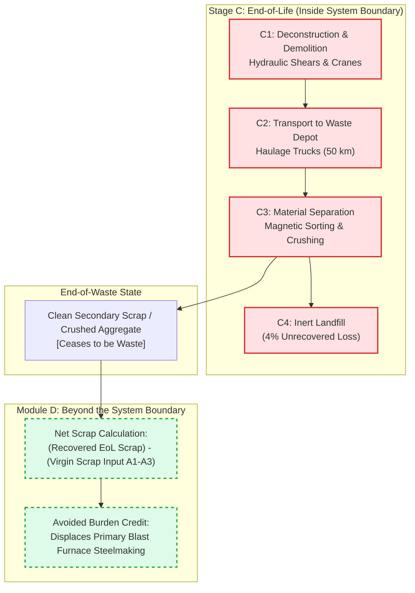

# Lesson 04: End-of-Life (Modules C1–C4), Circularity, and Beyond the Lifecycle (Module D)

## Learning objectives

By the end of this lesson, you will be able to:
* Quantify emissions across all **End-of-Life modules (C1–C4)** per BS EN 15978 and RICS standards.
* Define the **End-of-Waste** boundary that separates Module C3 waste processing from Module D circularity credits.
* Apply the **Net Scrap Formula** under BS EN 15804+A2:2019 to prevent double counting of recycled content between Modules A1–A3 and Module D.
* Balance **biogenic carbon accounting** from cradle to grave under the static $-1/+1$ international standard rule.
* Formulate circular economy design strategies (such as Design for Deconstruction) that convert landfill burdens into secondary material credits.

---

## Key concepts

### 1. Stage C: The End-of-Life Phase (Modules C1–C4)

When a building reaches the conclusion of its functional life, the deconstruction, sorting, and disposal activities are categorized within **Stage C** [S01, S04]:

* **Module C1 (Deconstruction & Demolition):** On-site plant fuel (diesel excavators with hydraulic shears, concrete pulverizers, mobile cranes) consumed during tearing down the building structure and separating finishes.
* **Module C2 (Transport to Waste Processing / Disposal):** Freight logistics transporting demolished rubble, scrap steel, and mixed waste from the site to local transfer stations, recycling depots, or landfills.
* **Module C3 (Waste Processing for Reuse, Recovery & Recycling):** Mechanical processing required to prepare secondary materials for a subsequent product system (e.g., crushing concrete into aggregate, shredding timber for biomass, baling scrap steel).
* **Module C4 (Final Disposal):** Permanent deposition of unrecovered waste into landfills or incineration without energy recovery.

#### Empirical Benchmark Values for Stage C
In typical building life cycle assessments, Modules C1–C4 contribute approximately $15 \text{ to } 40\text{ kgCO}_2\text{e}/\text{m}^2 \text{ GIA}$ (typically 3% to 7% of total cradle-to-grave emissions) [S04, S05]:
* C1 (Demolition): $5 \text{ to } 12\text{ kgCO}_2\text{e}/\text{m}^2$ (based on diesel intensity of $0.035 \text{ to } 0.050\text{ liters/t}$ of demolished mass).
* C2 (Transport): $3 \text{ to } 8\text{ kgCO}_2\text{e}/\text{m}^2$ (assuming default distance of 50 km to transfer station).
* C3/C4 (Processing & Landfill): $10 \text{ to } 25\text{ kgCO}_2\text{e}/\text{m}^2$.

---

### 2. Module D: Benefits and Loads Beyond the System Boundary

**Module D** quantifies the net environmental benefits or loads resulting from materials, products, or energy that exit the building system boundary and displace virgin production in another subsequent product system [S01, S02, S03]:

* **Recycled scrap:** Displacing virgin iron ore, virgin bauxite, or virgin glass sand.
* **Reused elements:** Displacing newly fabricated structural beams or bricks.
* **Energy recovery:** Incinerating waste timber with heat and power recovery, displacing fossil electricity or gas heating on the municipal grid.

#### The "End-of-Waste" State
Under EN 15804+A2 [S02], activities up to the point where a discarded material reaches the **End-of-Waste state** belong inside the building's own inventory (**Module C3**). Once the material has been cleaned, crushed, or sorted so that it can directly substitute for a primary raw material in an industrial process, all further transformations and the resulting displacement credits belong in **Module D**.

```
Demolition (C1) -> Haulage (C2) -> Sorting & Crushing (C3) | [END OF WASTE] | -> Substituted Virgin Production (Module D)
```

---

### 3. The Net Scrap Method: Preventing Double Counting

A major pitfall in carbon accounting is **double counting** recycled content [S04, S05]. If a structural steel beam already benefits from high recycled content during its upfront manufacturing stage (Module A1–A3), the project cannot claim credit for sending all of that steel to a recycler at end of life without adjusting for the scrap consumed at the outset!

Under BS EN 15804+A2 [S02] and RICS 2023 [S04], Module D must be calculated using the **Net Scrap** formula:

$$\text{Net Scrap} = M_{\text{recovered at EoL}} - M_{\text{recycled scrap input at A1-A3}}$$

$$\text{Module D Credit} = \text{Net Scrap} \times \left( \text{EF}_{\text{virgin primary}} - \text{EF}_{\text{scrap recycling}} \right)$$

Where:
* $M_{\text{recovered at EoL}} = M_{\text{installed}} \times R_{\text{recovery}}$ (where $R_{\text{recovery}}$ is the end-of-life recovery rate, e.g., 95% for structural steel).
* $M_{\text{recycled scrap input}} = M_{\text{purchased}} \times R_{\text{recycled input}}$ (the scrap percentage in the original product).
* $\text{EF}_{\text{virgin primary}}$ = Carbon factor for manufacturing 100% virgin material (e.g., BF-BOF primary steel: $\approx 2.30\text{ kgCO}_2\text{e}/\text{kg}$) [S05, S07].
* $\text{EF}_{\text{scrap recycling}}$ = Carbon factor for remelting scrap (e.g., EAF secondary steel: $\approx 0.45\text{ kgCO}_2\text{e}/\text{kg}$) [S05, S07].

#### Interpreting the Net Scrap Result
* If a building is a **Net Producer of Scrap** ($M_{\text{recovered}} > M_{\text{scrap input}}$), Module D yields a **negative carbon value** (a net climate benefit/credit).
* If a building is a **Net Consumer of Scrap** ($M_{\text{scrap input}} > M_{\text{recovered}}$), Module D yields a **positive carbon value** (a net burden).
* If a building uses $100\%$ virgin steel and recycles $95\%$ of it at end of life, its A1–A3 carbon is very high, but its Module D credit is very large.
* If a building uses $95\%$ recycled steel and recycles $95\%$ at end of life, its $\text{Net Scrap} \approx 0$, so its Module D is near zero—but its A1–A3 carbon was already exceptionally low!

---

### 4. Biogenic Carbon Dynamics: The Static $-1/+1$ Rule

Timber and bio-based materials sequester atmospheric carbon dioxide during tree growth ($1\text{ kg}$ of dry wood stores approximately $1.83\text{ kgCO}_2$) [S02, S05].

Under BS EN 15804+A2 [S02] and ISO 21930 [S03], lifecycle standards enforce a **closed-loop static mass balance**:
1. In **Module A1–A3**, biogenic carbon uptake is recorded as a credit:
   $$\text{GWP-biogenic}_{A1-A3} = -1.83\text{ kgCO}_2/\text{kg dry wood}$$
2. In **Modules C3/C4**, when the timber building is demolished and the wood is either incinerated or rots in landfill, that stored carbon is released back into the atmosphere:
   $$\text{GWP-biogenic}_{C3-C4} = +1.83\text{ kgCO}_2/\text{kg dry wood}$$
3. Over the full cradle-to-grave cycle ($A1–C4$), the net biogenic carbon balance equals:
   $$-1.83 + 1.83 = 0.00\text{ kgCO}_2\text{e}$$

> [!IMPORTANT]
> **Permanence & Energy Recovery:** If timber is incinerated with energy recovery at end of life, the $+1.83\text{ kgCO}_2$ is booked into Module C3/C4, while the avoided fossil fuel emissions from the generated district heat or power are credited in **Module D** [S02, S04].

---

## Worked example

### Problem Statement

A structural engineer is evaluating the end-of-life performance and Module D circularity credit for $150\text{ tonnes}$ of structural steelwork installed in a 5-story commercial frame.

#### Project Data:
* Installed structural steel mass ($M_{\text{installed}}$): $150\text{ tonnes}$ ($150{,}000\text{ kg}$).
* Wastage rate in A5 ($W$): $2\%$ ($M_{\text{purchased}} = 153\text{ tonnes}$).
* Recycled scrap content in original product ($R_{\text{recycled input}}$): $35\%$ ($0.35$).
* Demolition & sorting diesel consumption (C1): $0.040\text{ liters diesel/tonne}$ of steel.
  * Diesel emission factor: $3.18\text{ kgCO}_2\text{e}/\text{liter}$ [S04].
* Transport to scrap processing depot (C2): $40\text{ km}$ via HGV ($\text{EF}_{\text{trans}} = 0.088\text{ kgCO}_2\text{e}/(\text{t}\cdot\text{km})$) [S04].
* End-of-Life steel recovery rate ($R_{\text{recovery}}$): $96\%$ ($0.96$ is recovered for recycling; $4\%$ is lost to landfill) [S05].
* Scrap shredding and sorting processing (C3): $12.0\text{ kgCO}_2\text{e}/\text{tonne}$ [S04].
* Landfill disposal of unrecovered metal (C4): $8.0\text{ kgCO}_2\text{e}/\text{tonne}$ [S04].
* Material replacement carbon factors for Module D:
  * Virgin steel production ($\text{EF}_{\text{virgin}}$): $2{,}300\text{ kgCO}_2\text{e}/\text{tonne}$ [S05, S07].
  * Scrap remelting production ($\text{EF}_{\text{remelt}}$): $450\text{ kgCO}_2\text{e}/\text{tonne}$ [S05, S07].

**Calculate:**
1. Total End-of-Life emissions across Modules C1, C2, C3, and C4.
2. The Net Scrap tonnage exiting the system boundary.
3. The Module D circularity credit.
4. Explain how the results are reported alongside the building's cradle-to-grave inventory.

---

### Step-by-Step Solution

#### Step 1: Module C1 (Deconstruction / Demolition)

* Total diesel consumed:
  $$\text{Diesel} = 150\text{ tonnes} \times 0.040\text{ liters/tonne} = 6.0\text{ liters}$$
* Carbon emissions:
  $$\text{EC}_{C1} = 6.0\text{ liters} \times 3.18\text{ kgCO}_2\text{e}/\text{liter} = 19.08\text{ kgCO}_2\text{e} \approx 0.02\text{ tCO}_2\text{e}$$

---

#### Step 2: Module C2 (Transport to Scrap Depot)

* Carbon emissions:
  $$\text{EC}_{C2} = 150\text{ tonnes} \times 40\text{ km} \times 0.088\text{ kgCO}_2\text{e}/(\text{t}\cdot\text{km}) = 528.0\text{ kgCO}_2\text{e} \approx 0.53\text{ tCO}_2\text{e}$$

---

#### Step 3: Modules C3 and C4 (Processing & Disposal)

* **Recovered Steel Mass for Recycling (C3):**
  $$M_{\text{recovered}} = 150\text{ tonnes} \times 0.96 = 144.0\text{ tonnes}$$
  $$\text{EC}_{C3} = 144.0\text{ tonnes} \times 12.0\text{ kgCO}_2\text{e}/\text{tonne} = 1{,}728.0\text{ kgCO}_2\text{e} \approx 1.73\text{ tCO}_2\text{e}$$

* **Unrecovered Steel Mass to Landfill (C4):**
  $$M_{\text{landfill}} = 150\text{ tonnes} \times 0.04 = 6.0\text{ tonnes}$$
  $$\text{EC}_{C4} = 6.0\text{ tonnes} \times 8.0\text{ kgCO}_2\text{e}/\text{tonne} = 48.0\text{ kgCO}_2\text{e} \approx 0.05\text{ tCO}_2\text{e}$$

* **Total Stage C Emissions (C1–C4):**
  $$\text{EC}_{C1-C4} = 19.08 + 528.0 + 1{,}728.0 + 48.0 = 2{,}323.08\text{ kgCO}_2\text{e} \approx 2.32\text{ tCO}_2\text{e}$$

---

#### Step 4: Module D Net Scrap Calculation

* **Scrap Input at Production (A1–A3):**
  $$M_{\text{scrap input}} = M_{\text{purchased}} \times R_{\text{recycled input}} = 153.0\text{ tonnes} \times 0.35 = 53.55\text{ tonnes}$$

* **Recovered Scrap Output at EoL:**
  $$M_{\text{recovered}} = 144.0\text{ tonnes}$$

* **Net Scrap Output:**
  $$\text{Net Scrap} = M_{\text{recovered}} - M_{\text{scrap input}} = 144.0 - 53.55 = 90.45\text{ tonnes of net scrap}$$

* **Unit Avoided Burden Factor:**
  $$\Delta \text{EF} = \text{EF}_{\text{virgin}} - \text{EF}_{\text{remelt}} = 2{,}300 - 450 = 1{,}850\text{ kgCO}_2\text{e}/\text{tonne}$$

* **Total Module D Credit:**
  $$\text{Module D} = -\left( \text{Net Scrap} \times \Delta \text{EF} \right)$$
  $$\text{Module D} = -(90.45\text{ tonnes} \times 1{,}850\text{ kgCO}_2\text{e}/\text{tonne}) = -167{,}332.5\text{ kgCO}_2\text{e} \approx -167.33\text{ tCO}_2\text{e}$$

---

#### Step 5: Reporting Compliance

The project reports:
* **Stage C End-of-Life Total (C1–C4):** $+2.32\text{ tCO}_2\text{e}$ (included in the cradle-to-grave sum).
* **Module D Circularity Potential:** $-167.33\text{ tCO}_2\text{e}$ (reported in a separate column).
* Under EN 15978 [S01] and EN 15804+A2 [S02], the $-167.33\text{ tCO}_2\text{e}$ is **never** subtracted from the building’s A1–C4 total, ensuring transparent reporting of actual lifecycle emissions while demonstrating circular potential.

---

## Visual explanation

The diagram below tracks materials passing through demolition and the **End-of-Waste** boundary into the circular secondary materials market.



### Reading the Diagram

1. Operations inside **Stage C** represent activities funded and managed as part of the building's decommissioning.
2. The **End-of-Waste** state is the regulatory and physical threshold where processed material becomes commercially tradable secondary raw material.
3. Operations inside **Module D** calculate the avoided carbon burden conferred upon future industries, strictly kept outside the building's cradle-to-grave inventory.

---

## Practice

### Exercise 1: Net Scrap with High Recycled Input

Consider the same $150\text{ tonnes}$ of structural steelwork from the worked example, but this time fabricated via an Electric Arc Furnace with a very high recycled scrap content of $95\%$ ($R_{\text{recycled input}} = 0.95$).
* Installed mass: $150\text{ tonnes}$; Purchased mass ($2\%$ waste): $153\text{ tonnes}$.
* EoL Recovery rate: $96\%$ ($144\text{ tonnes}$ recovered).
* $\Delta \text{EF} = 1{,}850\text{ kgCO}_2\text{e}/\text{tonne}$.

Calculate:
1. The mass of scrap input consumed during upfront manufacturing (A1–A3).
2. The Net Scrap tonnage at end of life.
3. The Module D credit.
4. Explain why Module D is drastically smaller here than in the worked example, and why this is fair.

### Exercise 2: Biogenic Carbon End-of-Life Pathways

A cross-laminated timber (CLT) structure contains $400\text{ tonnes}$ of dry timber.
* In Module A1–A3, biogenic uptake was booked as $-1.83\text{ kgCO}_2/\text{kg} = -732{,}000\text{ kgCO}_2$ ($-732\text{ tCO}_2$).
* At Year 60, two end-of-life disposal scenarios are evaluated:
  * **Scenario A (Incineration with Energy Recovery):** $100\%$ of the timber is burned in an energy recovery plant, releasing $+732\text{ tCO}_2$ into Module C3, but displacing $450\text{ tCO}_2$ of fossil gas grid heating in Module D.
  * **Scenario B (Landfill):** $100\%$ of the timber is placed in an anaerobic landfill, where $50\%$ permanently remains stored as lignin, while $50\%$ decomposes into landfill gas ($50\% \text{ CO}_2$ and $50\% \text{ CH}_4$). Methane has a GWP of 28.

Evaluate:
1. The net cradle-to-grave biogenic carbon balance ($A1–C4$) for Scenario A.
2. The net Whole Life Carbon (including Module D) for Scenario A.
3. Explain why Scenario B (landfill methane) can be disastrous for Whole Life Carbon despite "permanent storage" of part of the wood.

---

### Answers and hints

#### Exercise 1 Answers
1. Scrap input in A1–A3:
   $$M_{\text{scrap input}} = 153\text{ tonnes} \times 0.95 = 145.35\text{ tonnes}$$
2. Net Scrap:
   $$\text{Net Scrap} = M_{\text{recovered}} - M_{\text{scrap input}} = 144.0 - 145.35 = -1.35\text{ tonnes}$$
3. Module D:
   $$\text{Module D} = -(-1.35\text{ tonnes} \times 1{,}850\text{ kgCO}_2\text{e}/\text{t}) = +2{,}497.5\text{ kgCO}_2\text{e} \approx +2.50\text{ tCO}_2\text{e}$$
4. Explanation:
   Module D is near zero (in fact, slightly positive, representing a negligible net burden of $+2.5\text{ tCO}_2\text{e}$) because the building consumed as much scrap at the start ($145.35\text{ t}$) as it returned at the end ($144.0\text{ t}$). This is equitable because the project already captured the massive carbon benefit upfront in **Module A1–A3** through an exceptionally low initial carbon footprint ($0.45\text{ kgCO}_2\text{e}/\text{kg}$ instead of $2.30$)!

#### Exercise 2 Answers
1. Scenario A ($A1–C4$):
   $$\text{Net Biogenic } (A1–C4) = -732\text{ tCO}_2 \text{ (A1–A3)} + 732\text{ tCO}_2 \text{ (C3)} = 0.00\text{ tCO}_2$$
2. Scenario A including Module D:
   $$\text{Net WLC} = 0.00\text{ tCO}_2 + (-450\text{ tCO}_2 \text{ in Module D}) = -450\text{ tCO}_2$$
3. Scenario B (Landfill):
   Even though half the carbon stays stored, the methane ($\text{CH}_4$) released from the decomposing half has a global warming potential 28 times greater than $\text{CO}_2$! The release of fugitive methane can generate far higher warming than the initial biogenic sequestration, turning the timber into a substantial net climate driver unless landfill gas capture rates exceed 90% [S02, S04].

---

## Next steps

In this lesson, you mastered the End-of-Life modules (C1–C4), the Net Scrap circularity formula, and the rules governing Module D and biogenic carbon.

Proceed to [Lesson 05: Practical Calculation Methodology, Benchmarking, and Case Study](05-calculation-methodology-and-case-study.md) for the synthesis lesson. We will connect bills of quantities, EPDs, uncertainty analysis, and climate benchmarks into a comprehensive comparative case study of a real building.

You can also simulate various circular recovery rates ($10\% \text{ to } 95\%$) in the [Whole Life Embodied Carbon Simulator](assets/interactive/embodied-carbon-calculator.html).

---

## References

- [S01] British Standards Institution / CEN. (2011). *BS EN 15978:2011: Sustainability of construction works — Assessment of environmental performance of buildings — Calculation method*. BSI Standards Limited. URL: https://knowledge.bsigroup.com/products/sustainability-of-construction-works-assessment-of-environmental-performance-of-buildings-calculation-method
- [S02] British Standards Institution / CEN. (2019). *BS EN 15804:2012+A2:2019: Sustainability of construction works — Environmental product declarations — Core rules for the product category of construction products*. BSI Standards Limited. URL: https://standards.iteh.ai/catalog/standards/cen/5e3df5f5-ef85-48b9-823a-fcf7e19ec355/en-15804-2012-a2-2019
- [S03] International Organization for Standardization. (2017). *ISO 21930:2017: Sustainability in buildings and civil engineering works — Core rules for environmental product declarations of construction products and services*. ISO. URL: https://www.iso.org/standard/62545.html
- [S04] Royal Institution of Chartered Surveyors. (2023). *Whole life carbon assessment for the built environment* (2nd ed.). RICS Professional Standard. URL: https://www.rics.org/profession-standards/rics-standards-and-guidance/sector-standards/building-surveying-standards/whole-life-carbon-assessment
- [S05] Gibbons, O. P., Orr, J. J., & Arnold, W. H. (2022). *How to calculate embodied carbon* (2nd ed.). The Institution of Structural Engineers (IStructE). URL: https://www.istructe.org/resources/guidance/how-to-calculate-embodied-carbon/
- [S07] Jones, C., & Hammond, G. (2019). *Inventory of Carbon and Energy (ICE) Version 3.0*. Circular Ecology / University of Bath. URL: https://circularecology.com/embodied-carbon-footprint-database.html
- [S09] Pomponi, F., & Moncaster, A. (2016). *Embodied carbon mitigation and reduction in the built environment – What does the evidence say?* *Journal of Environmental Management*, 181, 687–700. DOI: 10.1016/j.jenvman.2016.08.036
